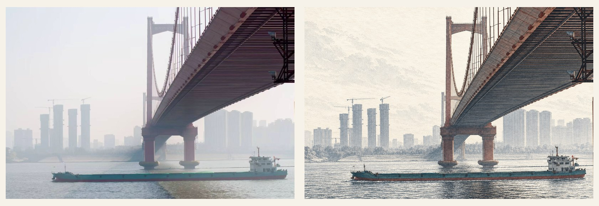
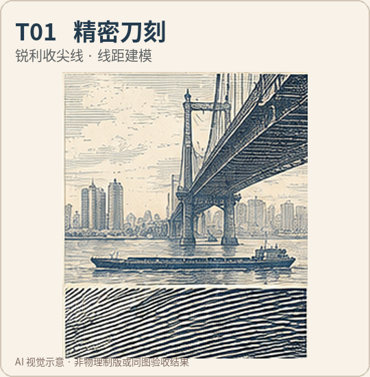
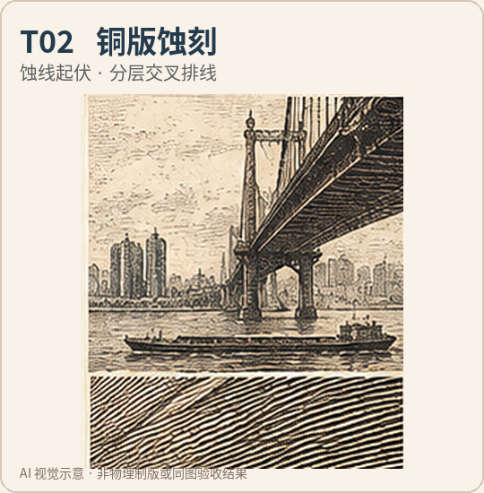
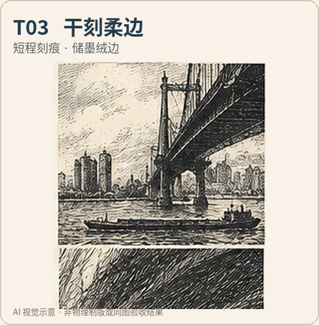
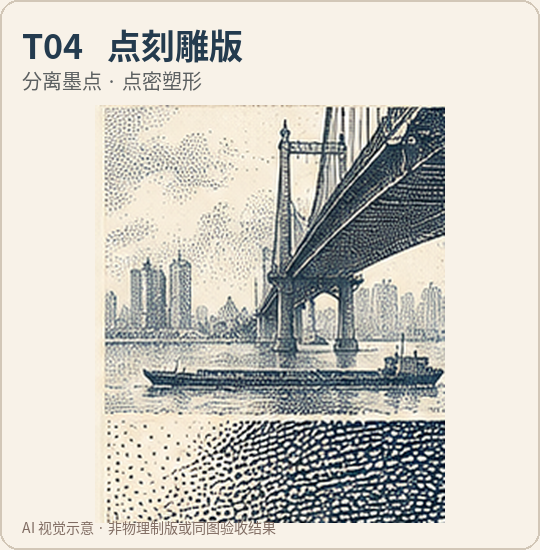
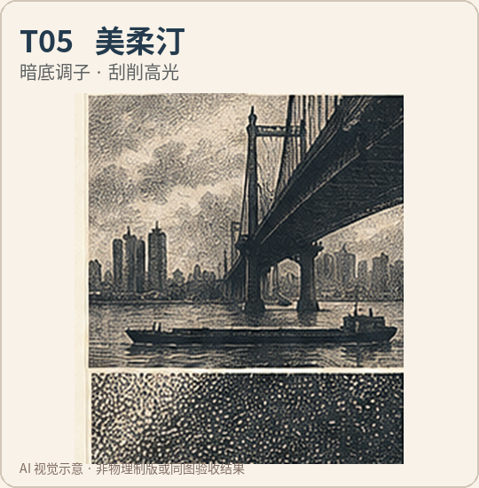
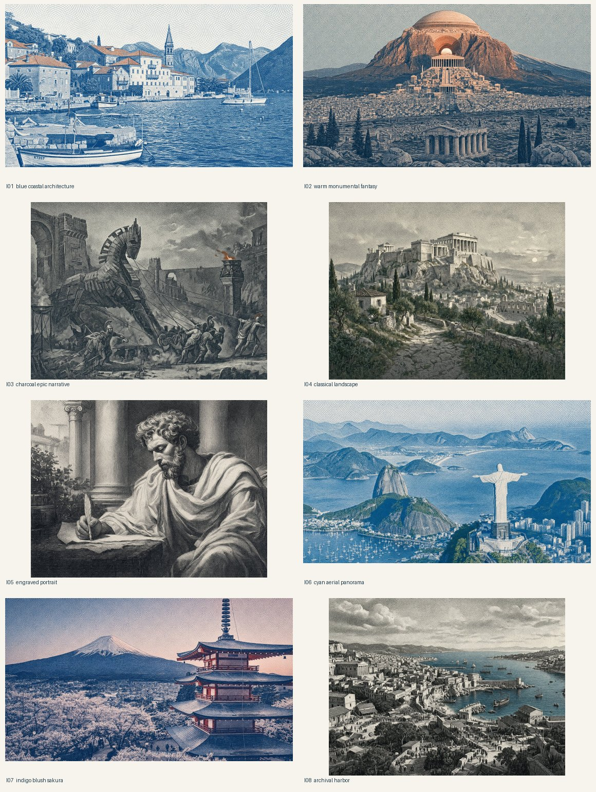

<div align="center">

# M1racle Intaglio Director

**让照片拥有真正不同的凹版雕刻语言。**

*Turn your images into engraving-inspired artwork — with more control over technique, color and composition.*

**5 种雕刻技法 · 8 套视觉配方 · 9 组色板 · 原图优先 · 受控生成**

**[下载完整 ZIP](https://github.com/ldohgfsdu/m1racle-visual-director/archive/refs/heads/main.zip)**

[快速开始](#-快速开始) · [风格图鉴](#-五种雕刻技法) · [完整示例](#-效果展示) · [使用说明](#-工作方式)

</div>

---

## ✨ 效果展示

这不是简单地给照片叠一层横向排线。**Intaglio Director 会为图像任务组织雕刻技法、线条方向、明暗、保真要求与配色约束**，再交由你使用的图像生成／编辑模型执行。



<sub>左：原始照片　｜　右：凹版视觉演示　·　[查看完整高清效果图](docs/images/bridge-engraving.png)</sub>

> **作品说明**：上图展示外部图像模型制作的凹版视觉方向；不代表仅运行本仓库 Python 脚本就能生成图片，也不代表已通过严格的逐像素保真评测。示意图可能存在小幅结构变化。

## 🖋️ 五种雕刻技法

同一题材也可以拥有不同的印痕结构，不再只是更换颜色或排线密度。

<table>
<tr>
<td align="center" width="33%"><br><b>T01 精密刀刻</b><br>锐利收尖 · 精准线距<br>建筑 / 桥梁 / 机械</td>
<td align="center" width="33%"><br><b>T02 铜版蚀刻</b><br>灵活蚀线 · 交叉排线<br>城市 / 风景 / 石材</td>
<td align="center" width="33%"><br><b>T03 干刻柔边</b><br>储墨毛刺 · 柔绒边缘<br>肖像 / 情绪画面</td>
</tr>
<tr>
<td align="center"><br><b>T04 点刻雕版</b><br>墨点疏密 · 柔和塑形<br>植物 / 纹理 / 细节</td>
<td align="center"><br><b>T05 美柔汀</b><br>绒黑暗调 · 刮亮高光<br>夜景 / 戏剧光影</td>
<td align="center"><br><b>选择一种主技法</b><br><br>每次生成都指定一个主导的形体塑造方式，避免所有风格变成同一种机械排线滤镜。</td>
</tr>
</table>

<sub>以上为 AI 生成的技法概念示意，不是五次受控的同图 A/B 测试，也不等于实体铜版制作。</sub>

## 🚀 快速开始

支持由视觉助手实际看图后，按结构、光影、细节、留白和气质推荐前 2–3 个配方；证据不足时使用 BASE。Python 负责校验和规则排序，仍不自行识图。使用方法与能力边界见 [视觉适配与风格传承](references/visual_director.md)。

**[点击下载完整 ZIP](https://github.com/ldohgfsdu/m1racle-visual-director/archive/refs/heads/main.zip)**

下载后解压，将 `m1racle-visual-director-main` 文件夹改名为 `m1racle-intaglio-director`。也可以在仓库顶部点击 **Code → Download ZIP** 下载。

### 方式一：在支持 Skills 的 AI Agent 中使用

**1. 安装**：按照所用 AI 工具的 Skills 安装方式导入解压后的 `m1racle-intaglio-director` 文件夹。保留 `SKILL.md`、`references/` 与 `scripts/`，不要只复制入口文件。

**2. 上传图片并输入：**

```text
使用 m1racle-intaglio-director 把这张照片重绘为凹版雕刻风格。
技法选 T02 铜版蚀刻，保留原有主体、视角、构图和颜色。
背景保持原样，不添加照片里不存在的物体。
```

**3. 获取结果**：如果当前 Agent 连接了可用的图像编辑模型，可按 Skill 的规则生成并检查图像；如果没有，Skill 应明确说明限制，交付可复制的生产提示词，**不会用 Python 自制滤镜冒充成品**。

### 方式二：只生成提示词，无需接入生图工具

需要 **Python 3.9+**。在项目目录中运行：

```bash
# 以下四条无需照片，可直接运行，验证不同技法和配方
python scripts/prompt_builder.py --subject "江边的古桥与雾中城市" --mode generate --technique T02 --lang zh
python scripts/prompt_builder.py --subject "江边的古桥与雾中城市" --mode generate --technique T01 --lang zh
python scripts/prompt_builder.py --subject "江边的古桥与雾中城市" --mode generate --technique T04 --lang zh
python scripts/prompt_builder.py --subject "古典山城" --mode generate --style I04 --lang zh
```

如果要对真实图片构建提示词，将下面命令中的路径换成自己的图片：

```bash
$ python scripts/prompt_builder.py --image ./photo.jpg --mode redraw --technique T01 --fidelity strict --lang zh
```

命令只生成**文字提示词**；`--image` 只核验本地图片文件信息，**不会识别画面、上传照片或生成图片**。要进行真正的图生图，请将提示词和原图一起交给具有图像编辑能力的模型。

## 🎨 不止五种风格：自由组合

将风格拆为三个可以独立指定的层次：

| 层次 | 控制什么 | 可选项 |
|:--|:--|:--|
| **T · 雕刻技法** | 线条／墨点／暗调如何构成形体 | `T01–T05` |
| **I · 视觉配方** | 画面节奏、构图气质和参考方向 | `I01–I08` |
| **P · 色彩方案** | 主墨、副墨和纸张颜色 | `P00–P08` |

例如 **T04 + I05 + P00** = 点刻 × 肖像配方 × 中性石墨。编辑照片时默认尽量继承原图颜色；只有明确指定色板或改色指令才主动改变颜色。

<details>
<summary><b>展开查看八套经典视觉配方（I01–I08）</b></summary>



这些样张代表场景组织和视觉气质，**不是**八种彼此独立的物理制版技法。

</details>

## ⚙️ 工作方式

成图后先检查主体、几何、构图和配色，再检查技法与所选配方的特征。缺少证据保持未验证；规则分数不能替代真实效果验收。详见 [成图验收与作品基准](references/output_review.md)。

```text
上传照片 / 输入主题
         ↓
判断任务：新生成 · 照片重绘 · 已有作品精修
         ↓
确认可用的图像工具与执行边界
         ↓
锁定主体、结构、视角、比例与颜色
         ↓
选择一种 T 技法 + 可选 I 配方 + 可选 P 色板
         ↓
生成可执行提示词
         ↓
有图像工具 → 实际生成并验收
无图像工具 → 交付提示词并停止
```

**设计原则：**尊重原图，不把风格样张里的建筑、船、花或人物“借”到你的照片里；刻线应服务于物体的形体与透视；不使用大面积同方向排线和摩尔纹伪装为精细雕刻。

<details>
<summary><b>进阶：一次生成五技法对照提示词</b></summary>

```bash
python scripts/compare_techniques.py \
  --subject "严格保留原图所有物体、构图和比例" \
  --mode redraw --palette "仅石墨黑和暖白纸色"
```

输出五份不同技法的**文本提示词**，供你用同一张原图和同一个生图模型进行真实对照。此命令本身不会输出五张图片。

更多说明：[技法细则](references/techniques.md) · [视觉配方](references/profiles.md) · [质量检查](references/quality_checks.md) · [A/B 测试协议](references/ab_protocol.md)

</details>

## ❓ 常见问题

**Q：安装 Skill 之后就能直接出图吗？**  
A：不一定。它负责组织风格与图像任务，真正成图取决于你使用的 Agent 是否接入可用的图像生成或编辑模型。

**Q：为什么不直接加一个“雕刻滤镜”？**  
A：全图统一叠线往往破坏结构、材质和空间。项目重点是让刻线、点刻或调子服从形体，而不是叠加机械纹理。

**Q：五种技法已经全部实测了吗？**  
A：相关配置和程序测试已经建立，但五技法的严格同图成图验收仍需真实图像模型验证；本页图片属于概念示意。

**Q：适合哪些内容？**  
A：建筑、风景、肖像、植物、城市、器物，以及有明确构图约束的照片重绘任务。

## 📦 项目内容

- `SKILL.md` — AI Agent 的操作规则与能力边界
- `references/` — 五技法、视觉配方、配色和质量标准
- `scripts/prompt_builder.py` — 中英文提示词生成
- `scripts/compare_techniques.py` — 五技法对照提示词
- `scripts/validate_skill.py` — 配置及程序自检
- `assets/` — 原有八套视觉配方参考图

运行自检：

```bash
python scripts/validate_skill.py
```

> 程序自检只覆盖配置和脚本逻辑，不等于图像生成模型的风格效果已得到验证。

---

<div align="center">

**M1racle Intaglio Director v1.3.0**

*Control the mark-making. Preserve the image. Stop when the tools cannot deliver.*

</div>
